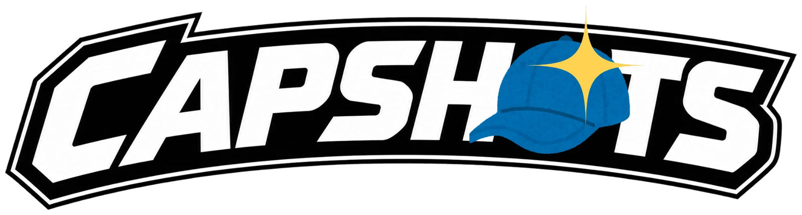

<p align="center"></p>

# Capshots

Capshots (formerly MultiplayerFPS) is a simple online multiplayer first-person shooter made in Unity, built while following Welton King's YouTube tutorial series. Networking is handled by [Photon Fusion](https://www.photonengine.com/fusion) in Host mode: one player hosts the match and decides hits and scores, with lag compensation so shots count where they landed on the shooter's screen. Photon's cloud matches players and connects them to the host (through its relay when a direct connection isn't possible), so nobody needs to run a server.

## Play

**In your browser:** go to **[steffhe.github.io/Capshots](https://steffhe.github.io/Capshots/)**. It works in desktop browsers (Chrome, Edge or Firefox) and on phones and tablets, which get on-screen touch controls (see below). On a computer, click the game to lock the mouse. **Esc** releases the mouse and opens the pause menu; click again after resuming to lock it. Crouch is on `Z` in the browser, because Ctrl+W would close the tab. During a match the browser asks before closing or reloading the tab.

**On Windows:**

1. Go to the [latest release](https://github.com/steffhe/Capshots/releases/latest).
2. Download the build from the **Assets** section and extract it.
3. Run the `.exe` file and enjoy!

To play together, each player runs the game, picks a username and either creates a room or joins one from the room list. Browser and Windows players on the same release can play in the same rooms.

## Features

- Online multiplayer through Photon Fusion: host rooms, browse and join open rooms, or quick-join a random one
- Room options: game mode, map, max players and kills to win
- Two game modes: Free For All, and Team Deathmatch (blue vs red, automatic team balancing, no friendly fire, first team to the kill limit wins)
- Several maps to choose from
- Warmup until enough players have joined, then a countdown before the match starts
- Four energy weapons (pistol, machine gun, sniper rifle and an 8-pellet shotgun) with aiming, reloading and weapon sway; laser beams and muzzle flashes glow in the shooter's colour (the team colour in Team Deathmatch)
- Hovering players: every player is a round little drone with a glowing face screen, blinking eyes and a thruster, in their own (or their team's) colour; it floats, bobs and leans into its movement over a glowing disc, and the gun drifts instead of bobbing with footsteps
- Weapon balance: damage falls off over distance, per-weapon headshot multipliers, heavier guns and aiming slow you down, and shots spread more while moving or jumping
- Sprinting, jumping, crouching and sliding
- Smarter spawns (away from enemies and out of their sight) and 3 seconds of spawn protection, which ends early if you shoot
- Health regeneration after 5 seconds without taking damage
- Every player wears a cap: the team colour in Team Deathmatch, otherwise a colour of their own
- Physics ragdolls: the body is thrown along the killing bullet's path, and the head (cap and all) comes off and flies separately, harder on a headshot
- Players drop an ammo box when they die; walk over it to refill your reserve ammo
- Scoreboard with kills, deaths and ping
- Text chat
- Settings menu: field of view, aim sensitivity, volume, graphics quality and key rebinding
- Gamepad support (Unity Input System)
- Graphics: colour grading, bloom, vignette, soft shadows, anti-aliasing (SMAA) and light fog on every map
- Sound: a distinct sci-fi shot for each gun, a hovering hum and woosh while moving (silent while crouching), a soft landing puff and energy-cell reload sounds, all heard in 3D from where they happen
- Combat feedback: camera recoil, muzzle flash, hit and kill sounds, a damage flash with a direction indicator, a kill feed and a "killed by" screen
- Levels and XP: earn XP for kills, finishing matches and winning, saved to your profile between sessions

## Controls

Keyboard and mouse controls can be changed in **Pause → Settings**. A gamepad also works.

| Action | Keyboard / mouse | Gamepad |
| --- | --- | --- |
| Move | `W` `A` `S` `D` / arrow keys | Left stick |
| Look | Mouse | Right stick |
| Shoot | Left mouse button | Right trigger |
| Aim | Right mouse button | Left trigger |
| Reload | `R` | X / Square |
| Switch weapon | `1` `2` `3` / mouse wheel | Bumpers |
| Sprint | `Shift` | Left stick press |
| Jump | `Space` | A / Cross |
| Crouch | `Left Ctrl` (`Z` in the browser) | B / Circle |
| Slide | `C` (while sprinting) | Right stick press |
| Scoreboard | Hold `Tab` | View / Select |
| Chat | `T` or `Enter` | - |
| Pause | `Esc` | Menu / Start |

### Touch controls (phones and tablets)

Hold the device sideways. On phones that allow it (Android), the game goes fullscreen on your first tap.

- **Move:** put your thumb anywhere on the lower left of the screen and drag; the joystick follows your thumb. Push it far forward to sprint (the knob turns yellow).
- **Look:** drag anywhere else on the screen. Dragging on the **FIRE** button turns the view too, so you can shoot and aim with one thumb.
- **AIM** is a toggle: tap to aim down sights, tap again to stop.
- **CROUCH** crouches when standing, and slides when sprinting.
- **JUMP**, **RELOAD** and **SWAP** (next weapon) are buttons on the right; **SCORE** (hold) and **II** (pause) are at the top.
- A keyboard, mouse or trackpad connected to a tablet works as on a computer. Using the mouse or trackpad hides the on-screen controls, and touching the screen brings them back. The keyboard works alongside them, including **Esc** to pause and **T** to chat.
- Without a keyboard, chat isn't available.

Look sensitivity for touch follows the aim sensitivity in **Pause → Settings**.

## Building from source

Requirements:

- [Unity](https://unity.com/download) **6000.6.9f1** (Unity 6)

Steps:

1. Clone the repository:
   ```bash
   git clone https://github.com/steffhe/Capshots.git
   ```
2. Open the project folder in Unity Hub with the editor version above.
3. Open `Assets/Scenes/Menu.unity` and press Play, or build via **File → Build Profiles**. The menu scene must be first in the scene list, followed by the map scenes.

Photon Fusion is configured in `Assets/Photon/Fusion/Resources/PhotonAppSettings.asset` (App ID) and `NetworkProjectConfig.fusion`. If you fork the project, create your own free Photon **Fusion** app and put its App ID there (or in `Assets/Editor/FusionSetup.cs` before running **Capshots → Set Up Fusion**).

## Tests

The tests in `Assets/Tests/EditMode` check gun ammo, damage falloff and XP. Run them in Unity from **Window → General → Test Runner → EditMode → Run All**. The build workflow also runs them alongside every build, and only publishes a release when they pass.

## Releasing

Builds are made automatically by GitHub Actions with [GameCI](https://game.ci) (`.github/workflows/build.yml`):

- **Release:** push a version tag. The Windows build is attached to a new GitHub Release, and the browser version is published to GitHub Pages:
  ```bash
  git tag v0.2
  ```
  ```bash
  git push origin v0.2
  ```
  The tag (without the `v`) becomes the game's version, which is also used as Photon's matchmaking version, so players on different releases never end up in the same room.
- **Pull requests** that change the project get a browser test build. Download it from the workflow run's **Artifacts**. It's built with WebGL's "Shorter Build Time" code optimization, so it builds faster but runs slower than a release, which uses "Runtime Speed". For a Windows test build, use **Run workflow** on the branch (Actions → Build). Draft pull requests only run the tests; the build starts when you mark the pull request ready for review.
- **Merges to `main`** only run the tests, not the builds: the pull request already built that code, and a release builds it again with its real version. The test run on `main` saves Unity's Library cache for the tests in later pull requests. Builds always start from a clean Library.
- **On demand:** run the **Build** workflow from the **Actions** tab.

The workflow needs three repository secrets (**Settings → Secrets and variables → Actions**): `UNITY_LICENSE` (the contents of your Unity license file, `Unity_lic.ulf`), `UNITY_EMAIL` and `UNITY_PASSWORD`. Without them, pull request builds are skipped with a warning.

Publishing the browser version needs GitHub Pages set up once:

1. **Settings → Pages → Build and deployment → Source:** choose **GitHub Actions**.
2. **Settings → Environments → github-pages → Deployment branches and tags:** add a rule for tags matching `v*`. By default only the `main` branch may publish there, and releases are published from tags.

## Project structure

| Path | Contents |
| --- | --- |
| `Assets/Scripts` | Game code: launcher/lobby, player movement, weapons, input, settings, chat, pause menu |
| `Assets/Scripts/Manager*.cs` | The match manager, split by topic: match flow (`Manager.cs`), teams, scoreboard, spawning, pickups, chat and XP |
| `Assets/Scripts/Core` | Game logic with no scene dependencies (`Gun`, `ProfileData`), in its own assembly so it can be tested |
| `Assets/Tests/EditMode` | Automated tests for the `Core` code |
| `Assets/Scenes` | `Menu` plus the playable maps |
| `Assets/Resources` | Prefabs loaded at runtime: the networked player, weapons, ragdoll and bullet holes |
| `Assets/Prefabs` | UI and misc prefabs |
| `Assets/Photon` | Photon Fusion 2 networking SDK (with Photon Realtime 5) |

## Credits

- Tutorial: Welton King's YouTube series on making a multiplayer FPS in Unity
- Networking: Photon Fusion by Exit Games
- Assets: Robot Kyle, SimplePoly Town Pack and Unity Starter Assets
