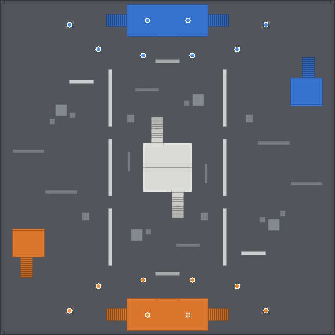

# Prototype map generator

The Prototype map is an open arena in the spirit of Proving Ground: a grid floor 80 m square,
three clear lanes split by two long walls, and a few blocks, crates and low walls for cover. It
replaced the asset-pack map that was there before, whose corridors made it a maze.



## Layout

| Area | Where (x, z) | What's there |
| --- | --- | --- |
| Base decks | x -10..10, back 8 m of each end | A deck 2.5 m up over the spawn, steps up at both ends, a parapet along its front with a gap in the middle to drop down from |
| Lane walls | x ±14, z -24..24 | Two walls 4.5 m tall (too tall to jump over), each with two 3 m gaps to cut between lanes |
| Tower | x -6..6, z -6..6 | A slab 3.4 m up with parapets, steps up from the south and the north, and a tunnel straight through underneath from west to east |
| Middle lane | x -14..14 | Crates, a low wall and a block each side of the tower, a low wall in front of each base |
| Side lanes | x 14..40 and -40..-14 | At one end of each lane a perch 2.5 m up looking up the lane (the west lane's at the south end, the east lane's at the north), at the other a crate cluster and a wall breaking the long sight line; low walls near the middle |

The south half is laid out, then placed again turned 180 degrees about the middle for the north
half, so both teams get the same cover at the same distances. Orange is the south team's side,
blue the north's, so you can tell which half you're in. 16 spawn points: 8 at each end, 2 of them
up on the deck.

Heights: steps are at most 0.25 m (players step 0.3 m, bots 0.45 m), low walls 1.2 m (cover to
shoot over), perches and decks 2.5 m, the tower 3.4 m, lane walls 4.5 m and the outer walls 6 m
(with the scene's invisible boundary walls at the same place, 40 m tall).

## How it fits the game

`Assets/Scenes/Prototype.unity` holds an `Arena` object (under `Map/Design`) whose `OfficeMap`
component builds the map when the scene loads, from `Assets/Resources/Maps/Prototype.txt`, the
same way as the Office: boxes merged into meshes per material, plain box colliders, and the spawn
points and map camera set on the Manager. The scene keeps its Manager, HUD, sun and boundary walls
(moved in to the new 80 m square). Bots build their navigation from the colliders as on every map.

## Changing the map

1. Edit `layout()` in `generate.py` (metres, x west to east, z south to north, y up; lay out the
   south half only).
2. Run it from the repository root (Python 3, standard library only):
   ```bash
   python3 Tools/PrototypeMap/generate.py --preview
   ```
   It writes `Prototype.txt`, redraws `preview.png` and fails if a spawn point stands on nothing or
   is blocked.
3. `PrototypeMapTests` (EditMode) checks the generated file: spawn points, the two halves matching,
   step heights and the map's edges.
