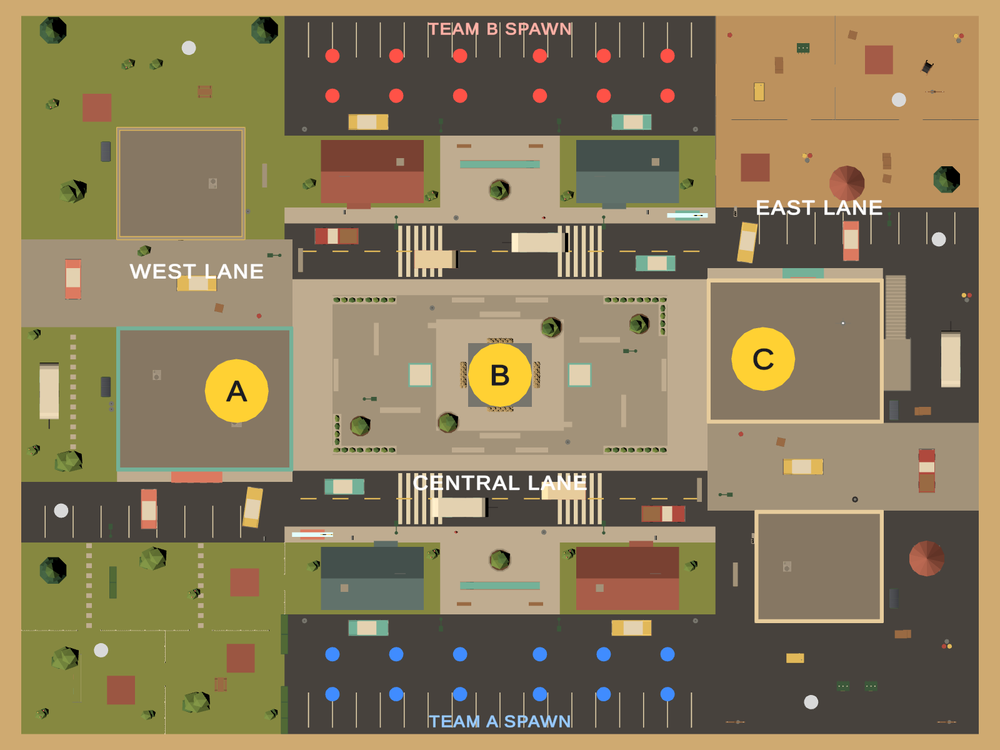
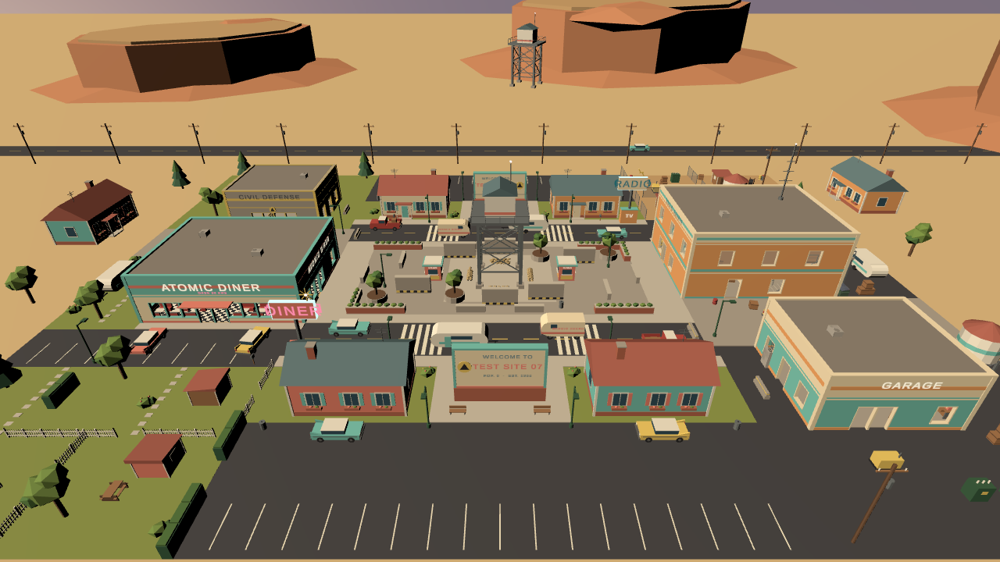

# Test Site 07

A compact three-lane map for 6v6: a 1950s desert town built as a nuclear test site, in flat-shaded
pastel low-poly. 120 x 90 m, one Unity unit per metre (x west to east, z south to north).

## Layout

| Area | Where (x, z) | What's there |
| --- | --- | --- |
| Team A spawn | 35-85, 3-14 | Visitor car park, 12 spawn points. Screened by two cottages and the welcome sign, with five ways out |
| Team B spawn | 35-85, 76-87 | The same, turned round |
| West lane | 0-36 | Backyards with picket fences, sheds, trees and a laundry line; the **Atomic Diner** (12-34, 33-51); the garden path down its west side; the civil defence depot behind it |
| Central lane | 37-83 | Two streets crossing the map (z 26-33 and 57-64) with parked cars, a camper and a bakery van; the **courtyard** (39-81, 35-55) with the test tower in the middle |
| East lane | 84-120 | Garage and service yard with transformers and a water tank; the **radio workshop** (86-108, 39-57); the service alley; utility yards |

The south half (team A's spawn up to the middle of the courtyard) is placed, then placed again
turned 180 degrees about the centre for team B, so both teams get the same cover at the same
distances. Turned round, a garden yard becomes a utility yard (picket fence to chain link, shed to
pump house), so the west lane stays gardens and the east lane stays industrial.

Three ways to rotate between lanes without going back to spawn: the two streets and the courtyard
(entrances on all four sides). The diner and the workshop each open onto the courtyard and the
streets.

**Buildings**

- **Diner** (one storey): dining room with booths, tables and a jukebox; a serving counter; the
  kitchen behind a wall with two doors and a serving hatch. Front double door, rear kitchen door,
  side doors to the courtyard and the alley, and windows on every side you can jump through (sill
  0.9 m, opening 2.4 m).
- **Radio workshop** (two storeys): workshop floor with benches and racks, a storage room, doors
  on all four sides, and a stair along the south wall. Upstairs, the radio control room, glazed all
  round (shots go through the glass both ways, players don't), with a door to a balcony and an
  outside stair down into the alley. So the high ground has two ways up and can always be shot back at.
- **Garage / civil defence depot**: through-routes with a wide door, a back door and a side door.
- **Courtyard**: planter walls and low walls round the edge, a kiosk, blast walls and sandbags
  inside, and the test tower over point B (walk under it between the legs).

## Gameplay checks

`Capshots > Test Site 07 > Validate` checks the saved scene with the player's real numbers (2 m tall,
0.5 m radius, 0.3 m step, 45 degree slopes, a jump that reaches 4.2 m, 10 m/s through the air) and
writes `Temp/TestSite07/validation.txt`. At the time of writing it reports no problems:

- every spawn point stands clear on the ground, inside its team's area
- the walkable mesh (player-sized) joins every spawn, objective, lane, room, the control room and the
  balcony; the walking routes between lanes stay out of both spawns
- 0 of 22,050 lines between the two spawn areas are clear (standing and jumping eye heights)
- nothing over 3 m can be reached by jumping from anything reachable, except the workshop's upper
  floor (highest reachable elsewhere: 2.95 m). Roofs are 7.2 m and up; thin tall things (trees, lamp
  posts, poles) have tall thin colliders so their tops can't be stood on
- no missing scripts, meshes, materials or prefabs; the Manager has its spawn points, map camera and
  NetworkObject; four 24 m boundary walls

Walking distance from each team's spawns: A 54 / 60 m, B 50 / 45 m, C 58 / 55 m.

## How it fits the game

- **Scene:** `Assets/Scenes/Test Site 07.unity`, made from the Prototype scene, so it keeps the same
  networked Manager, HUD canvas, event system and map camera. Build scene 5, and in the menu's map list.
- **Spawning:** the game's own spawn picker (farthest from enemies, out of their sight). Spawn points
  carry a new `SpawnSide`: in team modes a team prefers its own side (`Manager.ownSideSpawnBonus`,
  25 m), and the six lane spawns are free for all only. Maps without `SpawnSide` aren't affected.
- **Objectives:** there's no Domination mode yet, so A (27, 43, inside the diner), B (60, 45, under
  the tower) and C (93, 47, inside the workshop) are `ObjectiveMarker` transforms (label and 4 m
  radius) for a mode to find later. Nothing networked was added.
- **Boundary:** four invisible walls shown as force fields (`BoundaryField`), like the other outdoor maps.
- **Bots:** they build their navigation from the colliders when a match starts, as on every map.

## Art and performance

- Flat colours only (no textures except the diner's checker floor): about 35 shared URP Lit
  materials with GPU instancing, in `Assets/Prefabs/Test Site 07/Materials`.
- Every prefab's visual parts are merged into one mesh with one sub-mesh per material; collision is
  separate, as primitive box colliders on child objects. Everything static is marked for static
  batching, lightmapping and occlusion. About 1,900 objects, 81,000 triangles.
- Reused from the SimplePoly Town Pack: the dumpster, electrical panel and AC unit.
- Lighting: one real-time sun (mixed: baked bounce light, real-time shadows), trilight ambient,
  light fog, a light probe grid. The lighting settings (`Test Site 07 Lighting`) are ready for a
  bake, but nothing is baked yet, like Prototype and Downtown.

## Changing the map

Everything is generated by the editor scripts in `Assets/Editor/TestSite07`:

| File | What it makes |
| --- | --- |
| `Kit.cs` | Materials, flat-shaded shapes, and the prefab builder |
| `Props.cs` | Wall modules (wall, window, glazed window, door, corner, fascia) for each building style, and the props |
| `Buildings.cs` | Diner, radio workshop, garage, depot, roadside signs |
| `Layout.cs` | Where everything goes |
| `Builder.cs` | `Build Kit`, `Build Scene`, `Register In Build And Menu`, `Build Everything` |
| `Validator.cs` | `Validate` and `Capture Views` (pictures in `Temp/TestSite07`) |

Edit, run **Capshots > Test Site 07 > Build Everything**, then **Validate**. Assets are updated in
place, so their GUIDs and the references to them hold; a scene rebuild only replaces the scene's
`Map` object.
