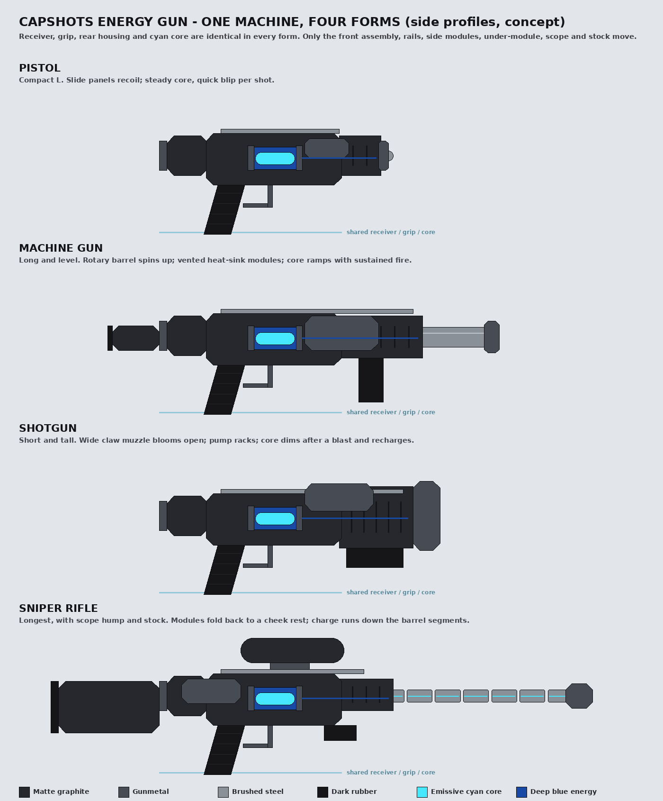
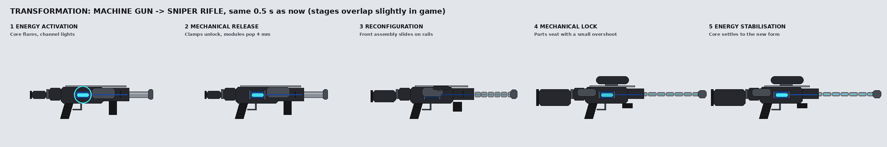
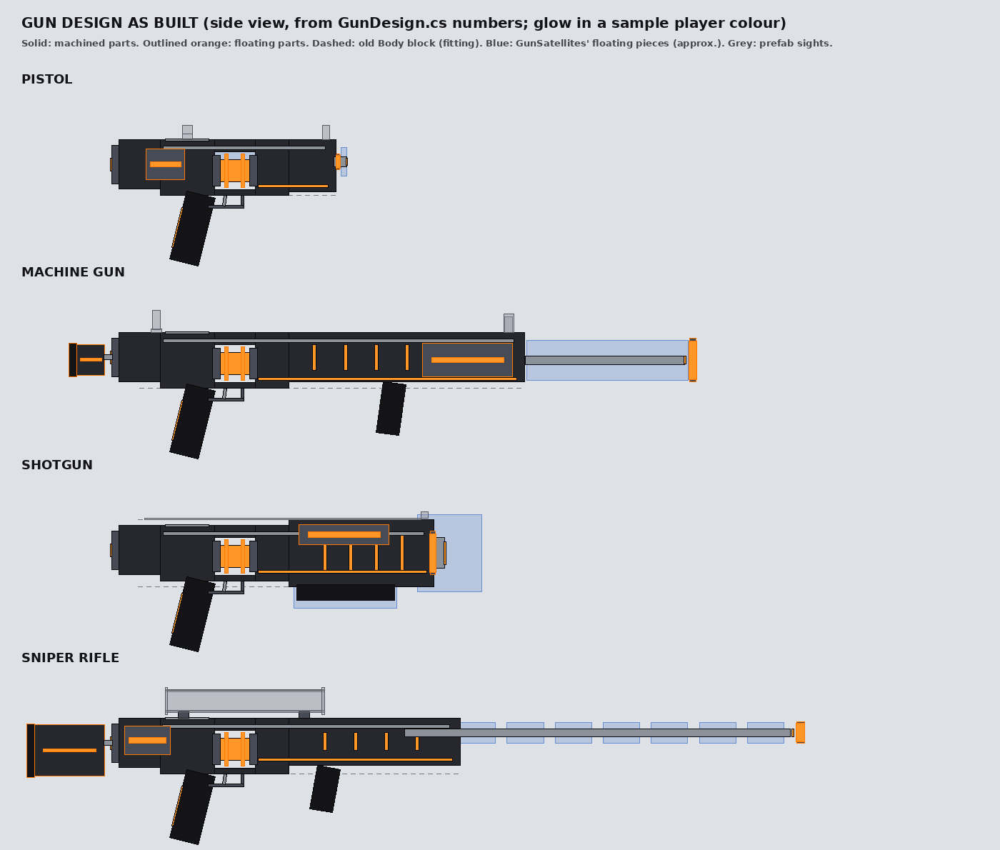

# Modular weapon redesign

The aim is one transforming machine with four forms. The receiver, grip, rear housing and cyan energy core stay the same in every form. Only the front assembly, rails, side modules, under-module, scope and stock reconfigure. Gameplay, damage, fire rates, energy and networking don't change.

**As built** (Stages 2 to 7, from the numbers in `GunDesign.cs` via [`layout_preview.py`](../../Tools/WeaponDesign/layout_preview.py)):

These are concept drawings from [`Tools/WeaponDesign/concept.py`](../../Tools/WeaponDesign/concept.py), not renders of the game. The part sizes in that script are the starting values for the in-game layout.

## 1. What's there now

| Area | Finding | Keep / reuse |
| --- | --- | --- |
| Models | `Assets/Resources/{Pistol, Machine Gun, Shotgun, Sniper Rifle}.prefab`. Each is 5 to 16 Unity built-in cubes under `Anchor/Design` (Body, Grip, Under, Barrel, Rib, sight posts), plus `States/Hip`, `States/ADS` and `Sights`. No imported meshes, textures or animation clips. | Keep the prefabs, the `Anchor`/`States`/`Sights` hierarchy and the per-form hip and aim poses (the aim alignment depends on them). Replace only the cubes under `Design`. |
| Materials | `Gun Metal` (URP Lit, base colour 0.075/0.08/0.09, metallic 0.92, smoothness 0.5) on almost everything. `Sight Glow`, `Pistol`, `Scope Reticle`, `Transparent 1` and `Gunfire` on the sights and effects. | Reuse `Gun Metal` as the gunmetal material. Add graphite, brushed steel, rubber and energy materials. |
| Floating pieces | `GunSatellites` + `Core/GunSatelliteLayout` (8 pieces): the sniper's segmented barrel, the machine gun's rotary slats, the shotgun's claw and pump plates, the pistol's slide panels. Their glow strips are in the player's (or team's) colour. They react to shots, aiming, the cell swap and energy level, and are tested in `GunSatelliteLayoutTests`. | Keep. They become the moving parts of the new front assemblies. Re-fit the layouts to the new parts. |
| Transformation | `Weapon.ShowGun` creates the new form's prefab and destroys the old one. `GunMorph` moves parts with the same name from the old shape to the new one over `morphTime` = 0.5 s. Parts only one form has fold in or out. | Keep `GunMorph`. If every form has every part, everything moves continuously, so nothing visibly swaps (see 3). |
| Hands | `DroneHands` holds the gun by the parts named `Body` and `Grip`, and animates the energy cell swap. | Keep both names on the new parts. Make the core the thing that gets swapped (see 4). |
| Networking | `Equipped` (networked, `OnChangedRender`), `MorphTimer`, `Energy` and `ReloadTimer` drive everything. All visuals already run locally from that state, on every machine. | Nothing changes. No new networked state is needed. |
| Third person | Other players see the same prefab, on the `Gun` layer instead of `LocalGun`. | The same model, with small details turned off on other players' guns for WebGL. |
| Main menu, awards, menu battle | `MenuBattle`, `MenuScenery` and `AwardStage` show the gun through `GunSatellites.AttachToDisplay`. | They get the new look for free if the prefabs change. Check them in Stage 6. |

## 2. Shared architecture

These parts appear in every form, always with the same name.

| Part | Material | Every form | Moves per form |
| --- | --- | --- | --- |
| Receiver (`Body`) | Matte graphite, bevelled | Same | No |
| Rear housing and rear cap | Graphite and gunmetal | Same | No |
| Grip (`Grip`), raked | Dark rubber | Same | No |
| Trigger guard | Gunmetal | Same | No |
| Energy core | Emissive cyan, in a deep-blue window with two gunmetal clamps | Same | Glow behaviour only |
| Top rail | Brushed steel | Same profile | Extends with the front assembly |
| Side modules (left and right) | Gunmetal | Same parts | Slide panels, heat sinks, shell plates or cheek rest |
| Front shroud | Graphite with vent slots | Same part | Length and height |
| Barrel | Brushed steel (floating segments on the sniper) | Same part | Length and bore |
| Muzzle | Gunmetal | Same part | Ring, rotary cap, wide claw or brake |
| Under-module (`Under`) | Rubber | Same part | Hidden, foregrip, pump or bipod block |
| Scope and mount | Graphite | Same part | Out on the sniper only |
| Stock and pad | Graphite and rubber | Same part | Stub on the machine gun, full stock on the sniper |

There's one thin deep-blue energy channel from the core to the front assembly. That, the core and the sniper's barrel segments are the only emissive surfaces.

## 3. Forms

| Form | Silhouette | Specific parts | Energy behaviour | Firing and recoil |
| --- | --- | --- | --- | --- |
| Pistol | A compact L | Short shroud, muzzle ring, slide panels | Steady, with a quick blip per shot | Slide panels snap back; sharp, short kick |
| Machine gun | Long and level, with a drop foregrip | Vented shroud, rotary barrel, heat-sink modules, stock stub | Ramps up with sustained fire, settles after | Rotary barrel spins up; small, fast kicks |
| Shotgun | Short and tall | Tall shroud, wide claw muzzle, pump, raised shell plates | Dims after a blast, then recharges over the fire interval | Claw blooms; pump racks; heavy kick |
| Sniper rifle | Longest, with a scope hump and a stock | Segmented barrel, muzzle brake, scope, folded-back cheek rest, full stock | Charge runs down the barrel segments on each shot | Segment ripple; slow, heavy kick |

Damage, fire rate, energy per shot and spread all stay as they are in `Assets/ScriptableObjects/Guns/*.asset`.

## 4. Transformation (0.5 s, unchanged)

| Stage | Share of the 0.5 s | What moves |
| --- | --- | --- |
| 1. Energy activation | 0 to 0.08 s | The core flares and the channel lights |
| 2. Mechanical release | 0.06 to 0.16 s | The clamps open and the side modules lift a few millimetres |
| 3. Reconfiguration | 0.12 to 0.40 s | The front assembly slides along the rail, parts retract or extend, the stock and scope fold, and the floating pieces re-form |
| 4. Mechanical lock | 0.38 to 0.45 s | Parts seat with a small overshoot, and the clamps close |
| 5. Energy stabilisation | 0.44 to 0.50 s | The core settles at the new form's level |

The stages overlap so it reads as one motion. Every part exists in every form, scaled to zero inside the receiver where a form doesn't use it, so `GunMorph` moves all of them continuously and no part pops in or out. A short clack plays at the lock, tied to the existing cell-swap sound.

The cell swap: the energy core is the cell. While `DroneHands` swaps it, the clamps open and the core slides out, and a fresh one clicks in. This would replace the capsule the hands carry today.

## 5. Implementation approach

1. A `GunParts` mesh kit, built in code like the hats (`PlayerCap`) and drone bodies (`DroneBody`): a bevelled box, a chamfered box, a cylinder, a ring and a vented box. The meshes are built once and shared by every gun, so there's no 3D modelling tool in the pipeline.
2. A `Core/GunDesign` layout (testable, like `GunSatelliteLayout`) holding each form's part poses. An EditMode test checks that every form has the same parts, that the receiver, grip and core are identical in every form, and that nothing reaches above the sights.
3. A `GunModel` component on each prefab that builds `Design` from `GunDesign` at load. The prefabs keep `Anchor`, `States` and `Sights`. `Body`, `Grip`, `Under` and `Barrel` keep their names for `DroneHands` and `GunSatellites`.
4. `GunMorph`: add the five stages, the lock overshoot and core glow keyframes.
5. Firing: per-form recoil curves on the existing kick, plus the core's energy behaviour, driven by `Weapon.LastShotTime` as the floating pieces already are.

### WebGL budget

- No more than 30 renderers and about 3,000 triangles per gun.
- 5 materials, all URP Lit, with glow levels and colours set per gun without extra material copies (the SRP batcher stays effective).
- No real-time lights, no new particle systems (the existing pooled shot effects are reused), and no textures beyond a small shared brushed-steel normal map.
- Other players' guns drop the small detail parts: vents, clamps, the channel line and the pad.

## 6. Decisions needed before Stage 2

1. **Cyan versus the player's colour.** Today the gun's glow, laser beams and muzzle flash are in the player's colour, or the team colour in Team Deathmatch, where it tells you which side someone is on. The proposal: a cyan core and channel on every gun, with the floating pieces' strips, beams and muzzle flash staying in the player or team colour. The alternative is everything cyan, which reads more clearly as one machine but loses that team cue.
2. **The core as the energy cell** (section 4): replace the capsule the hands carry during the swap?
3. **Review.** There's no Unity editor in this environment, so I can't see the result in game. I'd send each stage as a pull request so you can check the browser test build from CI before the next stage.

## 7. Outstanding

- Only side profiles are drawn. Top views and widths come in Stage 2, checked against the hand-orb positions.
- The sight positions per form stay where they are. The new shroud and scope are fitted around them, so aiming down sights doesn't move.

## 8. Decisions taken

1. **Colour:** every glowing part is in the player's colour (the team's colour in Team Deathmatch), like the floating pieces, beams and muzzle flash already are. There's no fixed cyan.
2. **The core is the energy cell.** The hand-orb pulls the core out from under the receiver and pushes a fresh one in, and the cell it carries is the core's size.
3. **No review between stages**, so the stages were built in one go. Each change is kept small and checked by the layout preview and the EditMode tests.
4. **More floating parts and more glow**, on top of the 8 floating pieces (GunSatellites), which are unchanged: the machine gun's rotary barrel, the sniper's barrel segments, the shotgun's claw and pump plates, and the pistol's slide panels.

## 9. Stage reports

### Stage 2: shared receiver, grip and core

- **New:**
  - `Assets/Scripts/Core/GunDesign.cs`: every part, per form, with its shape, finish, motion and whether it's shared.
  - `Assets/Scripts/GunParts.cs`: four unit meshes (box, bevelled prism, cylinder, ring) built once in code, and four materials (graphite, gunmetal, brushed steel, rubber) plus the drones' glow material.
  - `Assets/Scripts/GunModel.cs`: builds the parts onto a gun, then floats and lights them.
- **The receiver** is built round an open window. The core sits in it between two gunmetal clamps, with two glowing rings floating round it. Behind are the rear housing and a cap with a glowing disc; below are the raked rubber grip (with a glowing strip down its back), trigger and guard.
- **Changed:** `Weapon.ShowGun`, `MenuScenery`, `MenuBattle` and `AwardStage` call `GunModel.Build` on every gun they make.
- **The prefabs aren't edited.**
  - Their old `Body`, `Grip`, `Under` and `Barrel` blocks stay as invisible measuring blocks; only their renderers are removed. The floating pieces and hand-orbs are fitted round them exactly as before.
  - Sights, scope, aim poses and the hip and aim states are unchanged.

### Stages 3 and 4: the four forms

| Form | Front assembly | Floating parts | Glow |
| --- | --- | --- | --- |
| Pistol | Short shroud, stub barrel | Muzzle ring, side fins on the rear housing | Steady, a blip per shot |
| Machine gun | Long vented shroud, drop foregrip, a spindle down the rotary barrel | Muzzle ring at the tip, heat-sink modules, stock stub | The core and four vents heat up with sustained fire, then cool |
| Shotgun | Tall, wide shroud, pump, wide bore inside the claw | Muzzle ring, shell plates high on the sides | Dims after a blast and recharges; the vents flare |
| Sniper rifle | Slim shroud, a spindle through the barrel segments, muzzle brake, scope mounts | Muzzle brake ring, cheek plates, a full stock floating behind the cap | A flash, then a pulse down the channels and vents |

- **Shared by every form:** glowing energy channels down both sides, brushed steel rails, and glowing strips on the side modules.
- **Floating behaviour:** the floating parts breathe, kick out or forward with each shot, calm down while aiming and come loose during the cell swap.
- **Small parts** (vents, rails, strips, trigger) are left out of other players' guns.

### Stage 5: transformation

`GunMorph` moves the new parts in stages over the same 0.5 s:

1. The core flares.
2. Clamps, modules and the front assembly lift away from the receiver.
3. Every part slides to its new place.
4. The parts overshoot slightly and lock as the lift closes.
5. The glow settles.

The rings round the core spin up while it happens. The sights and floating pieces move as before.

### Stage 6: presentation

- **The core is the cell.** It disappears when the hand-orb reaches for it and pops back in as the fresh cell clicks home.
- **Spawn protection:** the parts go see-through on their own, as the floating pieces do.
- **Weight:**
  - About 45 parts per gun, drawn with 5 materials.
  - The meshes are shared by every gun, and colours are set per gun without extra material copies.
  - Glowing and small parts cast no shadows. Other players' guns skip about 15 small parts.
  - No new lights, particles or textures.

### Stage 7: testing

- **Tests:** `Assets/Tests/EditMode/GunDesignTests.cs` checks that:
  - every form has the same parts in the same order;
  - the shared parts are identical in every form;
  - the core and its rings fit the receiver's window;
  - nothing reaches above the sights;
  - each form has its own silhouette, and the forms get longer from pistol to sniper rifle;
  - parts come loose in the release stage;
  - the machine gun has at least 12 glowing and 10 floating parts.
- **Networking:** nothing new is sent. Everything is worked out from state every machine already has (form, shots, aiming, energy, the cell swap).
- **Not checked:** none of this has been compiled or seen in Unity here; there's no editor in this environment. It needs CI's build and a look in the game. Things to look at:
  - how bright the glow is;
  - the parts' finishes under each map's lighting;
  - where the hand-orb holds the core during the cell swap;
  - the machine gun and shotgun silhouettes from a distance.

## 10. Outstanding

- The HUD's gun icons (`Gun.image`) still show the old guns.
- There are no new sounds; a lock clack at stage 4 would fit.
- Per-form recoil curves weren't added. The guns keep their existing kick, and the new parts add their own per-shot motion on top.
